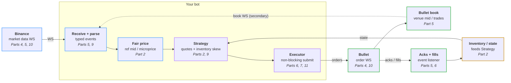

# HFT for dummies

The code behind the *HFT for dummies* series: a market maker you can run
yourself, built up one post at a time. It quotes **SOL-USD on
[Bullet](https://bullet.xyz)** using **Binance's SOL perp** as its price
reference.

Each part of the series is one change to this repo. Fork it, run it, and
watch it get better day by day.

> **Real money warning.** Market making can lose money, fast. The bot starts
> in **dry run** (no key, no money). Only go live with an amount you are
> happy to lose, and read [Going live](#going-live) first.

## What we're building



**Tick to trade** is the whole loop: Binance moves, we see it, we work out a
new fair price, decide our quotes, and get them onto Bullet before anyone
trades against our old ones. Then fills come back and change our inventory,
which changes the next quotes. Part 3 measures every hop. p50 is the middle;
p99 is the tail that gets you picked off.

## Quick start with a coding agent

Open the repo in your coding agent (Claude Code, Codex, Cursor, ...) and ask: *"Set me up and run the bot."* It installs what's missing, runs the
bot in dry run and explains what you're seeing. When you want real money,
ask it to go live: it walks you through the steps below and never touches
your private key or trades without your say-so (`AGENTS.md` has its rules,
and most agents read it automatically).

The steps below are the same thing by hand.

## Run it (no money)

Needs [Rust](https://rust-lang.org/install.html) (any version; the repo pins
the one it uses and cargo fetches it). Tested on Mac and Linux; Windows
should work but you're on your own.

```sh
cargo run
```

The first build takes a couple of minutes. Then, after about a minute of
warm-up:

```text
DRY RUN: watching SOL-USD and logging the quotes we would place. No orders are sent.
learning the Binance-to-Bullet price gap (takes about a minute)
quoting
paper: place side=Buy price=100.556 size=0.05
paper: place side=Sell price=100.758 size=0.05
bullet mid 100.656 | fair 100.6573 | our bid 100.556 ask 100.758 | position 0 | pnl $0 (fees $0)
```

The bot is pricing SOL off Binance and quoting either side of it on Bullet,
on paper. `FILL` means the real market traded through a paper quote. Ctrl-C
stops it. Tweak `bot.toml` (`spread_bps`, `skew_bps`, ...) and run again.

## How the code is laid out

Everything that happens becomes an **event** on one queue. The **market
maker** answers events with **intents** ("place this", "cancel that"), and an
**executor** carries them out. Each part of the series changes one box and
leaves the rest alone.

| File | Box in the diagram | What it does |
|------|--------------------|--------------|
| `src/events.rs` | arrows | The vocabulary: every `Event` in and `Intent` out. Start here. |
| `src/binance.rs` | Binance, Receive + parse | Binance best bid/ask → events |
| `src/bullet.rs` | Bullet, Bullet book, Acks + fills | Bullet book and our fills → events; sends orders |
| `src/book.rs` | Bullet book | Keeps our copy of the Bullet order book in sync |
| `src/fair_value.rs` | Fair price | Binance mid + the average Binance→Bullet gap |
| `src/strategy.rs` | Strategy | Where to put the bid and ask: spread, skew, limits |
| `src/market_maker.rs` | Strategy | The decisions: events in, intents out. No network, fully tested |
| `src/inventory.rs` | Inventory / state | Position and profit, changed only by fills |
| `src/key.rs` | | Reads `bot.key`, whatever form you pasted it in |
| `src/executor.rs` | Executor | Live (real orders) or paper (dry run) |
| `src/bot.rs` | the loop | Wires it all together |
| `bot.toml` | | Every setting, with comments |

Run the tests any time with `cargo test`.

## Going live

Only do this once dry run makes sense to you.

1. **Fund a Bullet account with about $20 of USDC.** Open **[app.bullet.xyz/trade?r=HFT4DUMMIES](https://app.bullet.xyz/trade?r=HFT4DUMMIES)**
   (referral code `HFT4DUMMIES`), connect a Solana wallet (e.g. Phantom),
   and bridge in about $20 of USDC from Solana. $20 covers the defaults (at
   most 0.1 SOL held, plus two resting orders) at 1x; with $10, set the
   account's leverage to 2-3x.
2. **Give the bot a delegate key.** A delegate key can place and cancel
   orders for your account but can't withdraw anything, so your funds stay
   put even if the key leaks.

   ```sh
   cargo run -- keygen
   ```

   This writes `bot.key` (git-ignored; never share it) and prints a link to
   Bullet's Delegate accounts page. Open it, click **Confirm Delegation**,
   and sign. The private key never leaves your machine. (Already have a
   delegate key? Paste its private key into `bot.key` instead.)
3. **Switch off dry run.** In `bot.toml` set `dry_run = false`.
4. **Run it:** `cargo run`. After the warm-up, two orders appear in
   the Bullet app either side of the price. Ctrl-C stops the bot and cancels
   them.

**Don't trade SOL-USD by hand on that account while the bot runs:** it
cancels every SOL-USD order there and treats any SOL-USD position as its own
(it refuses to start on one bigger than `max_position`).

What protects you (`bot.toml`):

- `max_position = "0.1"`: never holds more than 0.1 SOL (~$10), long or short.
- `max_loss_usd = "2"`: stops quoting after a $2 loss.
- Quotes are pulled when Binance or the Bullet book goes quiet, or the
  connection drops. Orders are post-only, so they never cross the book.

Stopping the bot, or the loss limit, **doesn't close your position**. Check
the Bullet app afterwards.

## Troubleshooting

| You see | It means |
|---------|----------|
| `command not found: cargo` | [Install Rust](https://rust-lang.org/install.html), then open a new terminal. |
| `...that address isn't a delegate` | The key in `bot.key` isn't a delegate on your account yet. Approve it in the Bullet app, check you pasted the **private** key (not the address), and check `network` in `bot.toml`. |
| `reading the key file bot.key` | There's no `bot.key` in this folder. See Going live, step 2. |
| `order_size ... is below ...'s minimum` or `must be a multiple of` | Change `order_size` in `bot.toml` to a size the market accepts (SOL-USD: steps of 0.01). |
| `placing orders failed` (repeatedly) | Usually not enough margin: deposit more, raise the account's leverage, or lower `order_size`. Nothing is lost; the bot just isn't quoting. |
| `cancel all failed` | Couldn't confirm our orders were cancelled. Check the Bullet app and cancel any SOL-USD orders by hand. |
| `position bigger than max_position` | The account already holds more SOL-USD than the bot ever would (you traded it by hand?). Close it or raise `max_position`. |
| Stuck on `learning the Binance-to-Bullet price gap` for minutes | Binance isn't reachable from your network (some countries block it). Look for `binance: connect failed`. |

## Following along

Each part lands on `master` as one PR, tagged `part-N`. Pull the latest
(`git pull`, or from `upstream` in a fork), or check out any part with
`git checkout part-3`.

| Part | Post | Code |
|------|------|------|
| 1 | Intro: the tick-to-trade loop | this README |
| 2 | Borrowing Binance's brain: clone, run, quote | `part-2` |
| 3 | Measure once, cut twice: telemetry | coming |
| 4 | AWS colocation | coming |
| 5 | Stop polling: websockets | coming |
| 6 | Optimising order execution | coming |
| 7 | How to not get rekt by API rate limits | coming |
| 8 | Linux tuning | coming |
| 9 | Optimising the hot path | coming |
| 10 | AWS last mile | coming |
| 11 | Bonus: nonces | coming |

## License

Apache-2.0. Not financial advice.
