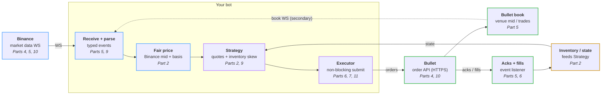

# HFT for dummies

Code for the *HFT for dummies* series: a market maker that quotes SOL-USD on
[Bullet](https://app.bullet.xyz/trade?r=HFT4DUMMIES), priced off Binance's SOL
perpetual future (perp). Each post is one change to this repo.

> Market making can lose money. The bot starts in **dry run**: no key, no
> orders.

## What we're building



Binance moves, we reprice, requote on Bullet, and fills feed back into
inventory. The series makes that loop fast: from a Binance update to our new
order resting on Bullet.

## Run it

Needs [Rust](https://rust-lang.org/install.html). Tested on Mac and Linux.

```sh
cargo run
```

After a minute of warm-up it quotes, on paper:

```text
quoting
paper: place side=Buy price=100.556 size=0.05
paper: place side=Sell price=100.758 size=0.05
bullet mid 100.656 | fair 100.6573 | our bid 100.556 ask 100.758 | position 0 | pnl $0 (fees $0)
```

Settings are in `bot.toml`. Using a coding agent? Ask it to *"set me up and
run the bot"*; `AGENTS.md` has its instructions.

## Going live

1. **Deposit $20 USDC** on [Bullet](https://app.bullet.xyz/trade?r=HFT4DUMMIES)
   (referral code `HFT4DUMMIES`).
2. **Make the bot a key:** `cargo run -- keygen`. It writes `bot.key`
   (git-ignored) and prints a link to
   [Delegate Accounts](https://app.bullet.xyz/delegate-accounts) with the
   key filled in: click **Confirm Delegation**. A delegate can trade but
   never withdraw.
3. **Run it live:** `cargo run -- --live`. Two orders appear either side of
   the price, marked ▸ in the app's order book (set its
   granularity to 0.1 or finer). Ctrl-C cancels them.

Limits in `bot.toml`: at most 0.1 SOL held, stops after a $2 loss. Stopping
doesn't close your position, and the bot cancels any SOL-USD orders you
place by hand on the same account.

## The code

Feeds turn the world into **events**, the market maker answers with
**intents**, an executor carries them out.

| File | |
|------|--|
| `src/events.rs` | Every `Event` in and `Intent` out. Start here. |
| `src/bot.rs` | The loop that wires it together |
| `src/binance.rs`, `src/bullet.rs` | Feeds; `bullet.rs` also sends orders |
| `src/book.rs` | Our copy of the Bullet order book |
| `src/fair_value.rs` | Binance mid + average Binance→Bullet gap |
| `src/strategy.rs` | Bid and ask prices: spread, skew, limits |
| `src/market_maker.rs` | Events in, intents out. No I/O, fully tested |
| `src/inventory.rs` | Position and PnL, changed only by fills |
| `src/executor.rs` | Live orders, or paper ones in dry run |

## Following along

Each part is one PR on `master`, tagged `part-N`, with a short guide in
[`docs/parts/`](docs/parts/). `git checkout part-N` runs the bot as of that post.

| Part | Post | Guide |
|------|------|------|
| 1 | Introduction: the tick-to-trade loop | — |
| 2 | Hello World | [guide](docs/parts/02-hello-world.md) · [`part-2`](https://github.com/bulletxyz/hft-for-dummies/tree/part-2) |
| 3 | Telemetry and latency measurement | [guide](docs/parts/03-telemetry.md) · [`part-3`](https://github.com/bulletxyz/hft-for-dummies/tree/part-3) |
| 4 | Colocation on AWS | coming |
| 5 | Streaming market data | coming |
| 6 | Order execution | coming |
| 7 | Rate limits | coming |
| 8 | Linux tuning | coming |
| 9 | Optimising the hot path | coming |
| 10 | Network optimisation on AWS | coming |
| 11 | Nonce management | coming |

## Scoreboard

The [standard benchmark](docs/parts/03-telemetry.md#the-scoreboard) at the end
of each part: 10 minutes quoting live with `bench-live.toml`, Part 3 on a
laptop and the rest on the Tokyo server. It splits one trip around the loop:

```text
 Binance update ──► reaches us ──► waits in our queue ──► we decide ──► order to Bullet ──► our order is open
                   binance→us         queue             tick-to-trade    order-to-live
 └─────────────────────────────────────── end-to-end ───────────────────────────────────────┘
```

| Part | end-to-end p50 / p95 | Binance → us p50 | tick-to-trade p50 | order-to-live p50 / p95 | queue p99 / max |
|---|---|---|---|---|---|
| 3 | 224 / 383 ms | (clock off) | 11 µs | (clock off) | 464 / 828 ms |

## Incidents

Things that went wrong while building this live, and what each taught us.
Details in each part's guide.

| Part | Incident | Lesson |
|------|----------|--------|
| 2 | Binance socket went silent, no error | Silence isn't "nothing happened": time out and reconnect |
| 2 | Bullet's websocket dropped a fill | Streams notify, records are truth: reconcile fills |
| 2 | An order filled during shutdown | Check fills once more before reporting |
| 2 | A cancel raced a fill | "Order not found" is normal; handle it (Part 6) |
| 3 | Laptop clock 288 ms behind: messages "from the future" | Sync clocks before measuring across machines |

## License

Apache-2.0. Not financial advice.
