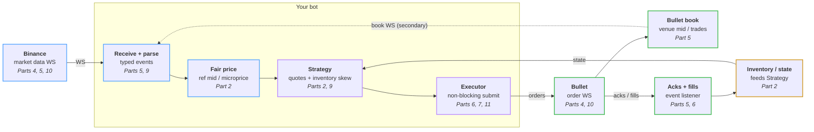

# HFT for dummies

Code for the *HFT for dummies* series: a market maker that quotes SOL-USD on
[Bullet](https://app.bullet.xyz/trade?r=HFT4DUMMIES), priced off Binance's SOL
perp. Each post is one change to this repo.

> Market making can lose money. The bot starts in **dry run**: no key, no
> orders.

## What we're building



Binance moves, we reprice, requote on Bullet, and fills feed back into
inventory. That loop is *tick to trade*; the series makes it fast.

## Run it

Needs [Rust](https://rust-lang.org/install.html). Tested on Mac and Linux.

```sh
cargo run
```

After a minute of warm-up it quotes, on paper:

```text
quoting
paper: place side=Buy price=100.556 size=0.05
paper: place side=Sell price=100.758 size=0.05
bullet mid 100.656 | fair 100.6573 | our bid 100.556 ask 100.758 | position 0 | pnl $0 (fees $0)
```

Settings are in `bot.toml`. Using a coding agent? Ask it to *"set me up and
run the bot"*; `AGENTS.md` has its instructions.

## Going live

1. **Deposit $20 USDC** on [Bullet](https://app.bullet.xyz/trade?r=HFT4DUMMIES)
   (referral code `HFT4DUMMIES`).
2. **Make the bot a key:** `cargo run -- keygen`. It writes `bot.key`
   (git-ignored) and prints a link to
   [Delegate Accounts](https://app.bullet.xyz/delegate-accounts) with the
   key filled in: click **Confirm Delegation**. A delegate can trade but
   never withdraw.
3. **Set `dry_run = false`** in `bot.toml` and `cargo run`. Two orders appear
   either side of the price; Ctrl-C cancels them.

Limits in `bot.toml`: at most 0.1 SOL held, stops after a $2 loss. Stopping
doesn't close your position, and the bot cancels any SOL-USD orders you
place by hand on the same account.

## The code

Feeds turn the world into **events**, the market maker answers with
**intents**, an executor carries them out.

| File | |
|------|--|
| `src/events.rs` | Every `Event` in and `Intent` out. Start here. |
| `src/bot.rs` | The loop that wires it together |
| `src/binance.rs`, `src/bullet.rs` | Feeds; `bullet.rs` also sends orders |
| `src/book.rs` | Our copy of the Bullet order book |
| `src/fair_value.rs` | Binance mid + average Binance→Bullet gap |
| `src/strategy.rs` | Bid and ask prices: spread, skew, limits |
| `src/market_maker.rs` | Events in, intents out. No I/O, fully tested |
| `src/inventory.rs` | Position and PnL, changed only by fills |
| `src/executor.rs` | Live orders, or paper ones in dry run |

## Following along

Each part lands on `master` as one PR, tagged `part-N` (`git checkout part-3`
to see the code as of that post).

| Part | Post | Code |
|------|------|------|
| 1 | Introduction: the tick-to-trade loop | — |
| 2 | Hello World | `part-2` |
| 3 | Telemetry and latency measurement | coming |
| 4 | Colocation on AWS | coming |
| 5 | Streaming market data | coming |
| 6 | Order execution | coming |
| 7 | Rate limits | coming |
| 8 | Linux tuning | coming |
| 9 | Optimising the hot path | coming |
| 10 | Network optimisation on AWS | coming |
| 11 | Nonce management | coming |

## License

Apache-2.0. Not financial advice.
