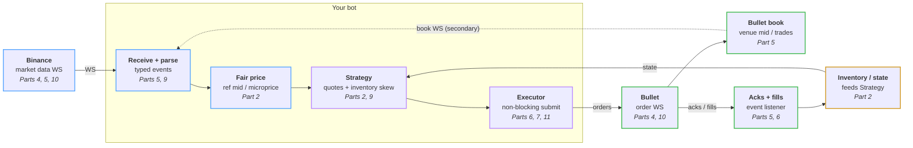

# HFT for dummies

The code behind the *HFT for dummies* series: a market maker you can run
yourself, built up one post at a time. It quotes **SOL-USD on
[Bullet](https://bullet.xyz)** using **Binance's SOL perp** as its price
reference.

Each part of the series is one change to this repo. Fork it, run it, and
watch it get better day by day.

> **Real money warning.** Market making can lose money, fast. The bot starts
> in **dry run** (no key, no money). Only go live with an amount you are
> happy to lose, and read [Going live](#going-live) first.

## What we're building



**Tick to trade** is the whole loop: Binance moves, we see it, we work out a
new fair price, decide our quotes, and get them onto Bullet before anyone
trades against our old ones. Then fills come back and change our inventory,
which changes the next quotes. Part 3 measures every hop. p50 is the middle;
p99 is the tail that gets you picked off.

## Run it (5 minutes, no money)

**1. Install Rust.** On macOS or Linux, paste this into a terminal and accept
the defaults:

```sh
curl --proto '=https' --tlsv1.2 -sSf https://sh.rustup.rs | sh
```

Then open a new terminal. On Windows, download and run
[rustup-init.exe](https://rustup.rs) instead. You don't need to pick a Rust
version: the repo pins one (`rust-toolchain.toml`) and `cargo` fetches it
the first time.

**2. Get the code.** Fork this repo on GitHub (button top right), then:

```sh
git clone https://github.com/<your-username>/hft-for-dummies.git
cd hft-for-dummies
```

(No git? `brew install git` on macOS, or [git-scm.com](https://git-scm.com).)

**3. Run it.**

```sh
cargo run --release
```

The first build downloads and compiles everything: a couple of minutes. Then
you'll see:

```text
DRY RUN: watching SOL-USD and logging the quotes we would place. No orders are sent.
binance: connected
bullet: connected symbol=SOL-USD tick=0.001 step=0.01 min_size=0.01
learning the Binance-to-Bullet price gap (takes about a minute)
...
quoting
paper: place side=Buy price=100.556 size=0.05
paper: place side=Sell price=100.758 size=0.05
bullet mid 100.656 | fair 100.6573 | our bid 100.556 ask 100.758 | position 0 | pnl $0 (fees $0)
```

That's the bot pricing SOL from Binance and quoting either side of it on
Bullet, on paper. When the real Bullet market trades through one of your
paper quotes you'll see a `FILL`. Press **Ctrl-C** to stop.

Now open `bot.toml`, change `spread_bps` or `skew_bps`, and run it again.

## How the code is laid out

Everything that happens becomes an **event** on one queue. The **market
maker** reads events and answers with **intents** ("place this", "cancel
that"). An **executor** carries the intents out. Each box in the diagram is
one file, so each part of the series changes one file and leaves the rest
alone.

| File | Box in the diagram | What it does |
|------|--------------------|--------------|
| `src/events.rs` | arrows | The vocabulary: every `Event` in and `Intent` out. Start here. |
| `src/binance.rs` | Binance, Receive + parse | Binance best bid/ask → events |
| `src/bullet.rs` | Bullet, Bullet book, Acks + fills | Bullet book and our fills → events; sends orders |
| `src/book.rs` | Bullet book | Keeps our copy of the Bullet order book in sync |
| `src/fair_value.rs` | Fair price | Binance mid + the average Binance→Bullet gap |
| `src/strategy.rs` | Strategy | Where to put the bid and ask: spread, skew, limits |
| `src/market_maker.rs` | Strategy | The decisions: events in, intents out. No network, fully tested |
| `src/inventory.rs` | Inventory / state | Position and profit, changed only by fills |
| `src/key.rs` | | Reads `bot.key`, whatever form you pasted it in |
| `src/executor.rs` | Executor | Live (real orders) or paper (dry run) |
| `src/bot.rs` | the loop | Wires it all together |
| `bot.toml` | | Every setting, with comments |

Run the tests any time with `cargo test`.

## Going live

Only do this once dry run makes sense to you.

1. **Make a Bullet account** at [app.bullet.xyz](https://app.bullet.xyz) and
   deposit about **$20 of USDC**. With the default settings the bot holds at
   most 0.1 SOL (about $10) plus two resting orders, and $20 covers that at
   1x leverage. To start with $10, set the account's leverage to 2-3x in the
   app; the bot's own limits stay the same.
2. **Give the bot a delegate key.** A delegate key can place and cancel
   orders for your account but can't withdraw anything, so your funds stay
   put even if the key leaks. Either:
   - **From the Bullet app:** in
     [Delegate accounts](https://app.bullet.xyz/delegate-accounts), create a
     delegate, copy its **private** key (base58), and paste it into a new
     file called `bot.key` in this folder. Or:
   - **Let the bot make one:** run `cargo run --release -- keygen`. It writes
     `bot.key` and prints a link; open it and confirm.

   Git ignores `bot.key`. Never share it or commit it.
3. **Switch off dry run.** In `bot.toml` set `dry_run = false`.
4. **Run it:** `cargo run --release`. Ctrl-C stops the bot and cancels its
   orders.

While it runs, **don't trade SOL-USD by hand on the same account.** The bot
cancels every SOL-USD order on the account when it starts, stops or
reconnects, and it counts any SOL-USD position as its own. If the account
already holds more SOL-USD than `max_position`, the bot refuses to quote
rather than trade your position down. Other markets are untouched.

What protects you, all in `bot.toml`:

- `max_position = "0.1"`: it never holds more than 0.1 SOL (about $10), long
  or short.
- `max_loss_usd = "2"`: after losing $2 in a run it stops quoting. It does
  **not** close your position. Do that in the Bullet app if you want to.
- It pulls its quotes when Binance or the Bullet book goes quiet, or the
  connection drops.
- Orders are post-only: they rest on the book or get rejected, never cross it.

Stopping the bot (or it crashing) leaves any position open. Check the Bullet
app after you stop it.

## Following along

Each part lands on `master` as one pull request and gets a tag (`part-2`,
`part-3`, ...). To pull the latest into your fork:

```sh
git remote add upstream https://github.com/bulletxyz/hft-for-dummies.git   # once
git pull upstream master
```

To look at the code as it was at a given part: `git checkout part-3`.

| Part | Post | Code |
|------|------|------|
| 1 | Intro: the tick-to-trade loop | this README |
| 2 | Borrowing Binance's brain: clone, run, quote | `part-2` |
| 3 | Measure once, cut twice: telemetry | coming |
| 4 | AWS colocation | coming |
| 5 | Stop polling: websockets | coming |
| 6 | Optimising order execution | coming |
| 7 | How to not get rekt by API rate limits | coming |
| 8 | Linux tuning | coming |
| 9 | Optimising the hot path | coming |
| 10 | AWS last mile | coming |
| 11 | Bonus: nonces | coming |

## License

Apache-2.0. Not financial advice.
